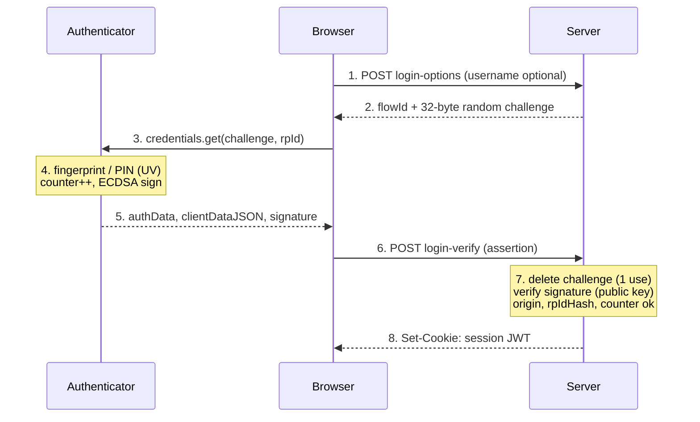
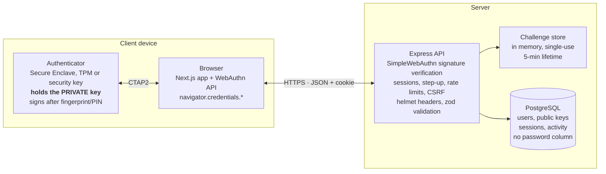

# Demo Guide — Passwordless Authentication Using Public-Key Cryptography

CNS course project · Team 14 · KLE Tech · October 2026

> Copy of the online guide: https://claude.ai/artifact/Y2cAUGGQEk2kbPPbYD1yyE

## Contents

1. [Overview](#1-overview)
2. [Before the demo](#2-before-the-demo)
3. [Demo script (about 12 minutes)](#3-demo-script-about-12-minutes)
4. [Cryptographic algorithms and parameters](#4-cryptographic-algorithms-and-parameters)
5. [Protocol internals](#5-protocol-internals)
6. [Security mechanisms and threat model](#6-security-mechanisms-and-threat-model)
7. [Attack simulator: the 19 scenarios](#7-attack-simulator-the-19-scenarios)
8. [Architecture, tech stack, data model and API](#8-architecture-tech-stack-data-model-and-api)
9. [Requirements traceability](#9-requirements-traceability)
10. [Performance results](#10-performance-results)
11. [Likely viva questions and answers](#11-likely-viva-questions-and-answers)
12. [Troubleshooting during the demo](#12-troubleshooting-during-the-demo)
13. [Limitations and future work](#13-limitations-and-future-work)

## 1. Overview

The project is a working website where users log in with no password: each device holds a private key that signs a one-time server challenge, and the server verifies it with the stored public key. It implements the FIDO2/WebAuthn standard, the same one behind Google, Apple and Microsoft passkeys.

**One-line pitch for the lecturer:** passwords fail because they are shared secrets that can be phished, reused and leaked; we replace them with public-key signatures, so the server stores nothing secret, and we prove it by running 16 real attacks live.

**What the demo proves:**

- No secret is ever typed, transmitted or stored (only public keys and bcrypt hashes in the database).
- Login is a cryptographic challenge–response, not a comparison of secrets.
- Private keys are created and kept inside the device's secure hardware.
- The system resists phishing, replay, man-in-the-middle tampering, credential stuffing, database leaks and cloned keys.
- Users can have several devices, revoke a lost one, and recover with a one-time code.

| Roll No. | USN | Name |
| --- | --- | --- |
| 146 | 01FE23BCS210 | Amogh Annigeri |
| 159 | 01FE23BCS291 | Mahesh Khatawate |
| 160 | 01FE23BCS295 | Raveesh Nayak |
| 161 | 01FE23BCS143 | Sathvik Kemtur |

## 2. Before the demo

Do a full practice run the night before, then repeat the start-up steps 15 minutes before the review.

**Start everything** (from the `app` folder; Docker Desktop must be running):

```bash
npm install
npm run db:up                 # PostgreSQL in Docker
npx prisma migrate deploy     # create / upgrade tables
npm run dev                   # web on :3000, API on :4000
```

**Checklist:**

- [ ] Docker Desktop running; `npm run dev` shows both servers started.
- [ ] `http://localhost:4000/api/health` returns `{"ok":true,...}`.
- [ ] Chrome open at `http://localhost:3000` (Chrome is best for the virtual authenticator).
- [ ] Touch ID / Windows Hello works, or a DevTools virtual authenticator is ready (DevTools → ⋮ → More tools → WebAuthn → Enable → Add).
- [ ] A fresh username ready (e.g. `team14-demo`); usernames cannot be reused.
- [ ] A second terminal open for `npm run demo:attacks` and `npx prisma studio`.
- [ ] Browser zoom at 110–125% so the projector is readable.
- [ ] Laptop on charger, notifications off.

**Roles (suggested):** one person drives the laptop, one narrates the cryptography, one handles questions on security, one on architecture and requirements.

## 3. Demo script (about 12 minutes)

Follow the steps in order; each has what to do and what to say. Steps 7 and 8 are optional if time is short.

1. **Landing page — the problem (1 min).** Open `http://localhost:3000`.
   - Say: "Passwords are shared secrets. 39% of breaches involve credential abuse. Our system removes the shared secret entirely: the device signs a challenge, the server verifies with a public key."
   - Point at the animated diagram: challenge goes server → device, signature goes device → server.
2. **Register (1.5 min).** Click *Get started*, enter a username, display name and device name, click *Create passkey*, touch the fingerprint sensor.
   - Say: "The browser called `navigator.credentials.create()`. The authenticator generated an ECDSA P-256 key pair inside secure hardware. Only the public key, in COSE format, was sent to the server."
   - Show the recovery code: "This is the backup. The server keeps only its bcrypt hash. We'll use it later."
   - Tick *I have saved my recovery code* and continue to the dashboard.
3. **Log out and log in (1 min).** Click *Log out*, then *Sign in with a passkey* (no username needed).
   - Say: "The server sent a 32-byte random challenge. My fingerprint unlocked the private key, which signed it. The server identified me from the signed user handle and verified the signature."
4. **Dashboard — the cryptography (2.5 min). The most important step.** Walk through the *Last ceremony* card:
   - `type = webauthn.get`, `challenge`, `origin = http://localhost:3000`: "The browser writes the real website origin into clientDataJSON. A phishing site cannot fake it."
   - `rpIdHash`: "SHA-256 of `localhost`. The key only works for this site."
   - Flags `UP` and `UV`: "User present and user verified: a fingerprint or PIN was actually checked."
   - `signCount`: "A counter that must always increase. If it goes backwards, the key was cloned."
   - `signature (DER, ~71 bytes)`: "The ECDSA signature over authenticatorData concatenated with SHA-256 of clientDataJSON."
   - Green checks: origin, RP ID hash, signature, counter, user verified, challenge single-use.
   - Point at *Active sessions* and *Recent activity* (FR-6, audit log).
5. **Devices — public key and multi-device (2.5 min).** Open *Devices*, click *Public key* on your device.
   - Say: "This PEM is everything the server knows about my device. There is nothing secret here."
   - Click *Generate link code*. Open a Chrome Incognito window (⇧⌘N), go to `http://localhost:3000/link`, enable a virtual authenticator in its DevTools (⋮ → More tools → WebAuthn → Enable → Add), enter username + code, click *Create passkey on this device*.
   - Say: "The new device created its own, separate key pair. The code is single-use, expires in 10 minutes and locks after 5 wrong guesses."
   - Back in the first window the list now shows 2 devices. Click *Revoke* on the new one, then refresh the Incognito window: it is signed out immediately.
6. **Security page — attack simulator (2 min). The "wow" moment.** Open *Security*, click *Run all attacks*.
   - Result: 19/19 behaved as expected — 16 attacks blocked, 3 legitimate flows allowed.
   - Explain three: phishing (wrong origin → 401), replay (challenge already used → 400), database leak (public key cannot sign → 401).
7. **Recovery (optional, 1 min).** Log out, open *Recovery*, enter username + saved code, register a replacement passkey with *Revoke all my existing devices* ticked.
   - Say: "The old devices are revoked, a new recovery code is issued, and the old code no longer works."
8. **Database proof (optional, 30 s).** Run `npx prisma studio`, open the `Credential` table: public keys only, no password column anywhere.
9. **Close (30 s).** "We met all five objectives: no shared secrets, challenge–response login, keys that never leave the device, resistance to common attacks, and multi-device use with recovery. Signature verification takes about 0.13 ms, far under our 1-second requirement."

**Backup if the browser misbehaves:** run `npm run demo:attacks` in the terminal; it prints the same 19 scenario results without a browser.

## 4. Cryptographic algorithms and parameters

The core primitive is ECDSA on the NIST P-256 curve with SHA-256 (COSE algorithm ES256, id −7), which gives about 128-bit security. Everything else supports it.

| Purpose | Algorithm | Parameters | Where |
| --- | --- | --- | --- |
| Device key pair + login signature | ECDSA P-256 / SHA-256 (ES256, COSE −7) | 256-bit private key, 64-byte public point (x, y); DER signature ~70–72 bytes | Authenticator; verified in `webauthn.ts` |
| Also accepted | EdDSA Ed25519 (COSE −8), RS256 RSA PKCS#1 v1.5 + SHA-256 (COSE −257) | per authenticator | `SUPPORTED_ALGORITHMS` |
| Binding to the website | SHA-256 | rpIdHash = SHA-256("localhost"), 32 bytes | first 32 bytes of authenticatorData |
| Binding to the request | SHA-256 | clientDataHash = SHA-256(clientDataJSON) | signed data = authData ‖ clientDataHash |
| Challenges | CSPRNG | 32 random bytes, base64url, single-use, 5-min TTL | `generateChallenge`, `challengeStore.ts` |
| User handle | CSPRNG | 32 random bytes per user | `newWebAuthnUserId` |
| Session token | JWT with HMAC-SHA-256 (HS256) | secret ≥ 32 chars in production, 1 h expiry, `jti` = session id, `alg:none` rejected | `auth.ts` |
| Recovery-code storage | bcrypt | cost factor 10, per-hash salt | `recovery.ts` |
| Recovery code | CSPRNG, rejection sampling | 16 symbols from a 31-char alphabet ≈ 79 bits | `generateRecoveryCode` |
| Device link code | CSPRNG + SHA-256 storage | 8 symbols ≈ 39 bits, 10-min TTL, 5 attempts, constant-time compare | `linkCodes.ts` |
| Recovery token | JWT HS256 | 10-min expiry, bound to SHA-256 of the current recovery hash | `signRecoveryToken` |
| Public-key fingerprint (display) | SHA-256 | first 16 bytes of the hash of the COSE key | Devices page |
| Encodings | CBOR, COSE_Key, base64url, ASN.1 DER, PEM/SPKI | — | attestation object, keys, signatures |

The signature the authenticator produces, and the server checks, is:

```text
σ = Sign_sk( authData ‖ SHA-256(clientDataJSON) )
Verify_pk( authData ‖ SHA-256(clientDataJSON), σ ) ∈ { true, false }
```

**How ECDSA works (for the viva):** the private key is a random integer d; the public key is the curve point Q = d·G, where G is the curve's base point. Signing picks a fresh random k, computes r = x-coordinate of k·G (mod n) and s = k⁻¹(H(m) + d·r) mod n; the signature is (r, s). Verification recomputes a point from H(m), r, s and Q and checks its x-coordinate equals r. Recovering d from Q is the elliptic-curve discrete logarithm problem, infeasible at 256 bits.

**Why P-256 instead of RSA:** a 256-bit EC key gives security comparable to a 3072-bit RSA key, with much smaller keys and signatures and faster signing, and it is supported by every platform authenticator.

## 5. Protocol internals

Both ceremonies are a request for options, one call to the authenticator, and a verification on the server; the account and the session are created only after the cryptography checks out.

**Registration (FR-1):**

1. Browser sends `POST /api/auth/register-options {username}`. The server refuses a taken username (409), generates a 32-byte challenge and a random user handle, and keeps them in the challenge store (no account yet).
2. Browser calls `navigator.credentials.create()` with rp.id = `localhost`, the challenge, the user handle, and allowed algorithms [ES256, EdDSA, RS256].
3. The user verifies (fingerprint / face / PIN); the authenticator generates the key pair and returns clientDataJSON plus an attestation object (CBOR) containing authenticatorData and the COSE public key.
4. Browser sends `POST /api/auth/register-verify`. The server checks the challenge, origin, rpIdHash, the UP/UV flags and the algorithm; then, in one database transaction, creates the user, stores the public key and the bcrypt hash of a new recovery code, and starts a session.

**Login (FR-2):**

1. `POST /api/auth/login-options {username?}` returns a `flowId` and a fresh challenge (with `allowCredentials` when a username is given; empty for usernameless login).
2. `navigator.credentials.get()`: the authenticator increments its counter and signs authData ‖ SHA-256(clientDataJSON).
3. `POST /api/auth/login-verify {flowId, assertion}`: the server deletes the challenge (single use), finds the credential by id, rejects it if revoked or owned by another user, checks the user handle, verifies the signature with the stored public key, checks origin, rpIdHash and that the counter increased, then creates a session row and sets a signed JWT cookie.



Only step 4 touches the private key, and it happens inside the authenticator; the server in step 7 needs nothing but the public key.

**clientDataJSON** (made by the browser, JSON):

| Field | Example | Why it matters |
| --- | --- | --- |
| type | `webauthn.get` / `webauthn.create` | stops a registration response being reused as a login |
| challenge | base64url of 32 random bytes | freshness: stops replay |
| origin | `http://localhost:3000` | written by the browser, not the page: stops phishing |
| crossOrigin | `false` | stops use inside a foreign iframe |

**authenticatorData** (made by the authenticator, binary):

| Bytes | Field | Meaning |
| --- | --- | --- |
| 0–31 | rpIdHash | SHA-256 of the RP ID (`localhost`) |
| 32 | flags | bit 0 UP user present · bit 2 UV user verified · bit 3 BE backup eligible · bit 4 BS backed up · bit 6 AT attested data · bit 7 ED extensions |
| 33–36 | signCount | 32-bit big-endian counter, clone detection |
| 37+ | attested credential data (registration only) | AAGUID (16 B), credential id length + id, COSE public key |

**COSE public key (ES256)** stored on the server: a CBOR map {1 (kty): 2 = EC2, 3 (alg): −7 = ES256, −1 (crv): 1 = P-256, −2: x (32 bytes), −3: y (32 bytes)}. There is no `d` (private) parameter: the server cannot sign.

## 6. Security mechanisms and threat model

Every threat named in the Review 1 problem statement has a specific mechanism and an automated scenario that proves it.

| Threat | Mechanism in this system | Scenario |
| --- | --- | --- |
| Phishing & spoofing | Origin in the signed clientDataJSON; rpIdHash in authenticatorData; keys scoped to one RP ID | `phishing-origin`, `phishing-rpid` |
| Replay | 32-byte challenge, bound to one `flowId`, 5-min TTL, deleted on first use | `replay` |
| Man-in-the-middle | Signature covers challenge + origin; any edited byte breaks it (TLS in production) | `mitm-challenge-swap` |
| Brute force / forgery | ECDSA P-256 (~128-bit); recovery code ~79 bits + bcrypt + 5 tries / 15 min per IP+username | `forged-signature`, `recovery-bruteforce` |
| Credential stuffing & reuse | No shared secret; a credential must belong to the claimed account | `credential-stuffing` |
| Server database breach | Only public keys and bcrypt hashes stored | `db-leak` |
| Cloned authenticator | Signature counter must strictly increase | `cloned-authenticator` |
| Lost / stolen device | Revocation rejects the key and ends its sessions; recovery can revoke all devices | `revoked-device` |
| Session hijacking | HttpOnly SameSite=Lax cookie, 1-h expiry, server-side session check, logout really revokes | `session-after-logout` |
| Unattended signed-in device | Step-up: add/revoke device and new recovery code need a passkey signature within 5 min | `step-up` |
| Account takeover at sign-up | Account created only after verification; taken usernames refused | `username-takeover` |
| Rogue device enrolment | Link code: created only after step-up, single-use, 10 min, 5 attempts | `link-code-guess` |
| Recovery abuse | Code rotates after use; recovery token bound to the code generation | `recovery-reuse` |
| CSRF | SameSite cookies, strict CORS allow-list, Origin check on every state-changing request | `csrf` |

**Defence in depth (also in place):** helmet security headers (CSP, HSTS, X-Frame-Options), per-IP rate limit (120 requests/min) on auth and recovery routes, input validation with zod on every endpoint, generic error messages that never leak internals, an audit log of every login success and failure with the reason, and a guard that stops you revoking your last device when no recovery code exists.

## 7. Attack simulator: the 19 scenarios

The simulator scores 19/19: 16 attacks are blocked and 3 legitimate flows succeed. It plays the attacker against the real API over HTTP, using a software FIDO2 authenticator (`softAuthenticator.ts`) that produces byte-exact WebAuthn responses: CBOR attestation objects, authenticatorData and DER ECDSA signatures. Throwaway accounts are deleted afterwards. Run it from the Security page, with `npm run demo:attacks`, or as `npm run test:integration`.

| # | Scenario | Expected | How the attack is built | Server response |
| --- | --- | --- | --- | --- |
| 1 | Legitimate registration and login | allowed | normal ceremony | 200, counter 0 → 1 |
| 2 | Usernameless login | allowed | empty allowCredentials; user found from signed userHandle | 200 |
| 3 | Linking a second device | allowed | one-time code, new key pair; code reused afterwards | 200, then reuse → 401 |
| 4 | Database leak | blocked | attacker reads the DB row and forges a signature with their own key | 401 |
| 5 | Phishing: look-alike origin | blocked | clientDataJSON.origin = `https://login-secure-bank.example` | 401 |
| 6 | Phishing: other RP ID | blocked | rpIdHash = SHA-256("evil.example") | 401 |
| 7 | Replay | blocked | same valid response sent twice | 200, then 400 |
| 8 | MITM challenge swap | blocked | challenge in signed clientDataJSON replaced | 401 |
| 9 | Forged signature | blocked | one signature byte flipped | 401 |
| 10 | Credential stuffing | blocked | attacker's valid passkey presented for the victim | 401 |
| 11 | Cloned authenticator | blocked | copied key replays an old counter | 401 "possible cloned authenticator" |
| 12 | Revoked device | blocked | stolen phone's session and new login after revocation | 401, 401 |
| 13 | Cookie reused after logout | blocked | stolen unexpired JWT replayed | 401 |
| 14 | Stale session | blocked | revoke a device with 1-hour-old authentication | 403 REAUTH_REQUIRED |
| 15 | Username takeover | blocked | register-options for an existing username | 409 |
| 16 | Recovery brute force | blocked | 7 rapid guesses | 401 ×5, then 429 |
| 17 | Recovery code reuse | blocked | used code and its old token tried again | 401, 401 |
| 18 | Link-code guessing | blocked | 6 guesses at a victim's link code | all 401; code locked |
| 19 | CSRF | blocked | POST with Origin `https://evil.example` | 403 |

## 8. Architecture, tech stack, data model and API

The system has two halves: the client device, where the private key lives, and the server, which verifies signatures and stores only public material.



The browser talks to the authenticator over CTAP2 and to the API over JSON with an HttpOnly session cookie; the API never sees a private key.

| Layer | Technology |
| --- | --- |
| Frontend | Next.js 14 (App Router), React 18, TypeScript, Tailwind CSS, lucide-react icons, `@simplewebauthn/browser` |
| Backend | Node.js 20+, Express 4, TypeScript, `@simplewebauthn/server` v12, zod, helmet, jsonwebtoken, bcryptjs |
| Database | PostgreSQL 16 with Prisma ORM (versioned migrations) |
| Testing | Vitest + Supertest (45 unit tests), 19 end-to-end scenarios against real PostgreSQL, Chrome virtual authenticator |
| Tooling | npm workspaces monorepo, Docker Compose for PostgreSQL |

**Data model** (no table has a password column):

| Table | Key columns | Purpose |
| --- | --- | --- |
| User | username (unique), displayName, webauthnUserId (random handle), recoveryCodeHash (bcrypt) | account identity |
| Credential | credentialID, publicKey (COSE, base64), algorithm, counter, transports, deviceType, backedUp, revokedAt | one row per device key; revoked rows kept for audit |
| Session | id = JWT jti, credentialId, expiresAt, lastAuthAt, revokedAt, ip, userAgent | logout, revocation, step-up |
| ActivityLog | type, message, deviceLabel, ip, createdAt | audit trail |

**Main API endpoints:**

| Endpoint | Purpose | Auth |
| --- | --- | --- |
| `POST /api/auth/register-options`, `register-verify` | create account + first passkey | none |
| `POST /api/auth/login-options`, `login-verify` | challenge–response login | none |
| `POST /api/auth/reauth-options`, `reauth-verify` | step-up re-authentication | session |
| `POST /api/auth/logout` | revoke current session | session |
| `GET /api/devices`, `PATCH /api/devices/:id`, `POST /api/devices/:id/revoke` | list, rename, revoke devices | session (+ step-up to revoke) |
| `POST /api/devices/link-code`, `POST /api/link/options`, `/api/link/verify` | link a new device with a one-time code | step-up / link code |
| `POST /api/recovery/verify`, `register-options`, `register-verify` | recovery with the one-time code | recovery token |
| `GET /api/sessions`, `POST /api/sessions/:id/revoke` | list and end sessions | session |
| `GET /api/activity`, `GET /api/users/me` | audit log, profile | session |
| `POST /api/demo/attacks` | run the attack simulator (development only) | none |

## 9. Requirements traceability

All six functional requirements and the non-functional requirements from Review 1 are implemented, and each one points to code and to a test or scenario.

| Requirement | What we built | Where to show it in the demo | Proof |
| --- | --- | --- | --- |
| FR-1 User registration | Client-side key pair; server stores public key + identity | Step 2 (Register) | `crypto.test.ts`, scenario 1 |
| FR-2 Challenge–response login | Single-use, time-bound challenges signed on device, verified on server | Steps 3–4 (ceremony inspector) | scenarios 7, 8, 9 |
| FR-3 Key storage & protection | Keys generated inside Secure Enclave / TPM / security key; only COSE public key persisted | Step 5 (public key PEM), step 8 (Prisma Studio) | scenario 4 |
| FR-4 Multi-device support | Many passkeys per account, link code, rename, list | Step 5 (link + list) | scenarios 3, 18 |
| FR-5 Revocation & recovery | Revoke ends sessions; rotating recovery code, optional revoke-all | Step 5 (revoke), step 7 (recovery) | scenarios 12, 16, 17 |
| FR-6 Session management | Session table + HS256 JWT in HttpOnly cookie, 1-h expiry, logout, step-up re-authentication | Step 4 (sessions card, step-up status) | scenarios 13, 14 |
| NFR Security | ES256 and the mechanisms in section 6 | Step 6 | 16 blocked attacks, 45 unit tests |
| NFR Usability | One-touch login, usernameless option, clear error messages | Step 3 | browser end-to-end run |
| NFR Performance (< 1 s) | Verification ~0.13 ms | Section 10 | `npm run bench` |
| NFR Scalability | Stateless signature checks, ~7,400 verifications/s per core, indexed credential lookup | Section 10 | `npm run bench` |
| NFR Compatibility | W3C WebAuthn Level 2 / FIDO2 CTAP2: Chrome, Edge, Safari, Firefox | — | standards |
| NFR Availability & reliability | Recovery code, multiple devices, last-device guard | Step 7 | `api.test.ts` |

**Five objectives → delivered:** eliminate shared secrets (only public keys + hashes stored) · challenge–response login · secure key management (keys never leave the authenticator) · resist common attacks (16/16 blocked) · usable multi-device experience (link devices, usernameless login, recovery).

## 10. Performance results

Every cryptographic operation finishes in well under a millisecond on average, about 7,000 times faster than the 1-second requirement. Measured with `npm run bench` (200 iterations, Node 24, Apple Silicon laptop).

| Operation | Mean (ms) | p95 (ms) | Max (ms) | Meets < 1 s? |
| --- | --- | --- | --- | --- |
| Key-pair generation + attestation (client side) | 0.04 | 0.06 | 0.47 | yes |
| Registration verification (server) | 0.06 | 0.08 | 2.98 | yes |
| Challenge signing (client side) | 0.02 | 0.03 | 0.30 | yes |
| Signature verification (server) | 0.13 | 0.19 | 2.35 | yes |

At 0.13 ms per verification one CPU core handles about 7,400 logins per second, so verification is never the bottleneck. In a real login the user's fingerprint touch (about 1 second) dominates; the full simulator scenario, including HTTP and database, takes 60–100 ms. Client-side numbers come from the software authenticator; real hardware (Secure Enclave, YubiKey) is slower but still well under a second.

## 11. Likely viva questions and answers

These are the questions most likely to come up, each with a short answer you can say aloud.

**Cryptography**

- **Which algorithm signs the challenge?** ECDSA over NIST P-256 with SHA-256 (COSE ES256, id −7). We also accept EdDSA (Ed25519) and RS256 if an authenticator prefers them.
- **What exactly is signed?** authenticatorData concatenated with SHA-256 of clientDataJSON. That covers the challenge, origin, RP ID hash, flags and counter.
- **Why can't the server log in as the user?** It holds only the public key Q = d·G. Getting d from Q is the elliptic-curve discrete log problem, infeasible at 256 bits.
- **Why a random challenge?** Freshness. Without it a recorded signature could be replayed. Ours is 32 random bytes, single-use, valid 5 minutes, tied to one login flow.
- **Why hash the clientDataJSON?** It binds the browser's view (challenge, origin, type) to the signature in a fixed 32-byte form.
- **Why bcrypt for the recovery code but not SHA-256?** bcrypt is deliberately slow and salted, so a leaked hash cannot be brute-forced quickly. Fast hashes suit link codes, which live 10 minutes and allow 5 tries.
- **What is the JWT signed with?** HMAC-SHA-256 (HS256) with a server secret. We pin the algorithm, so `alg: none` tokens are rejected, and every token's `jti` must match a live session row.

**Security**

- **How does it stop phishing?** The browser writes the real origin into clientDataJSON, and the authenticator scopes the key to the RP ID and puts SHA-256(RP ID) in the signed data. A fake site's origin and RP ID never match.
- **What if the database is stolen?** The attacker gets public keys and bcrypt hashes. Neither can produce a valid signature. Scenario 4 demonstrates it.
- **What if someone steals the phone?** They still need the fingerprint or PIN to unlock the key. The user can revoke the device from another device or via recovery, which also ends its sessions.
- **How is a cloned key detected?** The signature counter must strictly increase. A clone presents an old counter and is rejected and logged.
- **What is step-up authentication?** Sensitive actions (add or revoke a device, new recovery code) need a passkey signature from the last 5 minutes, so an unattended signed-in laptop cannot be abused.
- **Is the connection encrypted?** On localhost it is HTTP, which browsers treat as a secure context. In production it would run over HTTPS/TLS, and cookies become Secure.

**Design and comparison**

- **How is this better than OTP / SMS?** An OTP is still a shared secret: it can be phished, intercepted or SIM-swapped. Here nothing secret travels, and the signature only works on the real site.
- **Where is the private key stored?** In the platform authenticator: Apple Secure Enclave (Touch ID), the TPM (Windows Hello), Android's keystore, or a hardware security key. Our code never sees it.
- **What is FIDO2?** The FIDO Alliance standard made of WebAuthn (the W3C browser API) and CTAP2 (the browser-to-authenticator protocol).
- **What is attestation, and why `none`?** Attestation proves the authenticator's make and model. We use `none` for privacy and simplicity; production could verify it with the FIDO Metadata Service.
- **What if the user loses every device?** They use the one-time recovery code. It is rate-limited, rotates after use, and can revoke all old devices.
- **Why did linking from Safari fail on one Mac?** Safari and Chrome may share passkeys through iCloud Keychain or Google Password Manager, so WebAuthn sees the same authenticator and blocks the duplicate. That is the duplicate-device protection working.

## 12. Troubleshooting during the demo

Most problems come from the database not running or from the browser reusing the same authenticator.

| Symptom | Cause | Fix |
| --- | --- | --- |
| "Cannot reach the authentication server" | API not running | Check the `npm run dev` terminal; restart it |
| Server error on start / 500 errors | PostgreSQL down or tables missing | `npm run db:up`, then `npx prisma migrate deploy` |
| "That username is already taken" | Username used in a practice run | Pick a new username |
| "Add a security key here" asks for Bluetooth | This browser already holds your passkey; Chrome falls back to phone/QR | Use *Link a new device* with an Incognito window + virtual authenticator |
| Link page: "This browser is not a separate device" | Second browser shares iCloud Keychain / Google Password Manager | Incognito window + DevTools virtual authenticator; the code stays valid |
| "The passkey prompt was cancelled or timed out" | Prompt dismissed, or no matching key on this authenticator (for example a revoked one) | Try again; check the right authenticator is active |
| "Please confirm it is you with your passkey" | Step-up window (5 min) expired | Touch the sensor when prompted, or *Confirm with passkey* on the dashboard |
| Simulator shows failures | Database not running, or the API was restarted mid-run | Restart, run again; fall back to `npm run demo:attacks` |
| "Too many requests" | Rate limit hit during practice (120/min, recovery 5 per 15 min) | Wait a minute (15 for recovery), or restart the API to reset the limits |
| Virtual authenticator not used | It applies only to the tab where DevTools is open | Open DevTools in that same tab and keep it open |

## 13. Limitations and future work

This is an academic prototype: it has not had a security audit, certification or load testing, which were out of scope for Review 1.

- Challenges, rate-limit counters and link codes live in server memory, so a multi-server deployment would need a shared store such as Redis.
- Attestation is `none`; production could verify authenticator models against the FIDO Metadata Service.
- Recovery is a single one-time code; social or admin-assisted recovery is future work.
- It runs on localhost over HTTP; a real deployment needs a domain, HTTPS and matching RP ID and origin settings.
- Possible extensions: passkey autofill (conditional UI), the WebAuthn PRF extension for end-to-end encryption, and an admin view of security events.

**References:** W3C *Web Authentication Level 2* · FIDO Alliance *CTAP 2.1* · NIST SP 800-63B *Authentication and Lifecycle Management* · NIST FIPS 186-5 *Digital Signature Standard* · RFC 8152 / 9053 *COSE* · RFC 7519 *JWT* · Verizon *Data Breach Investigations Report* · SimpleWebAuthn documentation.
